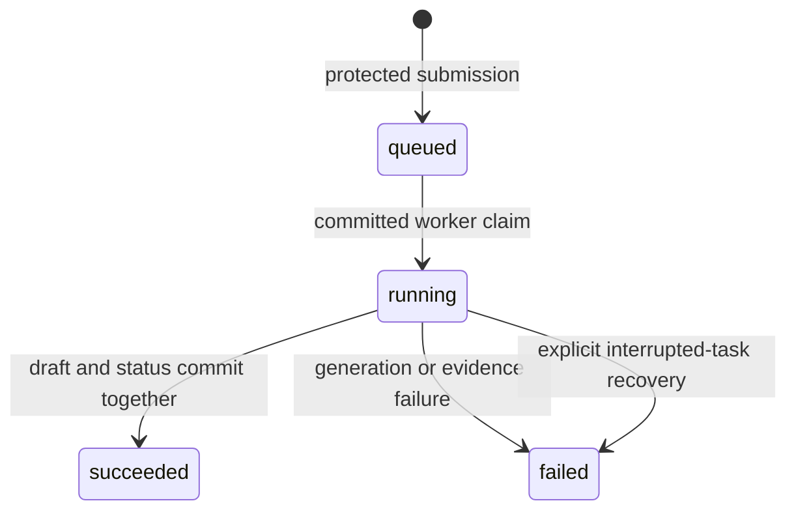

# Durable investigation tasks: first slice

The protected inbox can queue an investigation and show its persisted status.
A separate local worker creates an unreviewed draft. This slice uses status
polling; Pub/Sub delivery and SSE progress are the next integrations.

The task record is the source of truth. The web process never launches a model
request in memory after returning an HTTP response. This fits later delivery by
Pub/Sub without depending on the lifetime of the API process.

## Local use

Apply the additive migration from `backend`, then restart the backend:

```powershell
.\.venv\Scripts\python.exe -m alembic upgrade head
```

Open **Reviewer inbox**, unlock it, and choose **Investigation tasks**. Select a
stored run and choose **Queue investigation**. The server requires configured
Gemini access and current curated failed-job evidence. The fictional failed run
`demo/pipeline-assistant #1002` is suitable. The newly imported successful real
run has no failed-job evidence and is intentionally rejected.

Queueing saves a task and snapshot without making a model call. Copy the task
UUID from the list and run the separate worker from another terminal in `backend`:

```powershell
.\.venv\Scripts\python.exe -m app.task_worker --task-id TASK_UUID
```

This explicit command can consume Gemini quota or incur charges under the existing
account settings. It attempts at most one bounded generation for this task.
While tasks are queued or running, the inbox refreshes the twenty most recent
statuses every two seconds. **Review drafts** opens the existing private review
view after success. Neither queueing nor processing approves or publishes a report.

## Lifecycle and request identity



The browser generates one UUID for each submission. It sends that UUID as
`request_id` and the selected local `run_id` to `POST /api/reviewer/tasks`.
Reusing the same request UUID for the same run returns the original task;
reusing it for another run returns 409. An unconfirmed submission keeps its UUID
for an explicit retry. There are no automatic POST retries.

PostgreSQL locks the run while enqueueing. A partial unique index also enforces
one queued/running task per run. The snapshot includes only curated failed-job
evidence and is limited to the existing 64 KiB prompt budget. Model name, prompt
version and evidence fingerprint are stored with the task. The browser cannot
supply these values or an arbitrary snapshot.

`GET /api/reviewer/tasks` accepts a bounded `limit` (default 20, maximum 50).
`GET /api/reviewer/tasks/{uuid}` returns one status. Both omit snapshots and
report content. All routes require the existing reviewer bearer credential and
use private `no-store` response headers. Public endpoints remain read-only.

The run selector shows up to 100 recent public run summaries. The server remains
authoritative: a run can be displayed but lack curated failure evidence. Failed
status refreshes hide the previous task list; authorization failures lock the
inbox. Locking/closing discards private cache and credentials. An already accepted
task survives closing. If an unconfirmed request UUID was lost when closing,
inspect the persisted task list before submitting another request.

## Worker transactions and duplicate handling

1. Lock the task. Only `queued` may become `running`. Validate the stored snapshot,
   prompt version, model name and current evidence, then commit the claim.
2. Close the database session before awaiting the bounded Google ADK invocation.
3. Lock the task again. Validate the report and exact citations, recheck current
   evidence, and atomically store an unreviewed draft plus `succeeded` status.

A second delivery of a running or terminal task makes no model call. A stale or
invalid snapshot fails before calling the provider. Evidence that changes during
generation prevents the draft from being stored. Exceptions are represented by
fixed safe error codes; provider bodies, keys and traces are not persisted.

This protects one generation attempt per task, with a deliberate availability
trade-off. If a worker stops after committing its claim, the model may have
received a request even if no draft was saved. Automatically reclaiming that task
could charge twice. A failed final commit rolls back the draft and leaves the
task running; delivery of the same task still does not repeat generation.

For a running task older than 120 seconds, explicitly mark it interrupted:

```powershell
.\.venv\Scripts\python.exe -m app.task_worker --task-id TASK_UUID --mark-interrupted
```

This uses database time and does not call the provider. It cannot overwrite a
fresh or completed task. A late worker response cannot attach a draft once the
task is terminal. Inspect status before choosing a new submission: a new UUID
can make a new charged request. Interruption does not recall an already received
provider request. Failed tasks are never automatically retried.

The first slice has no automatic queued-task expiry, queued-task cancellation or
continuous worker loop. Queued work waits for its explicit local worker command.

## Pub/Sub and SSE integration plan

[Pub/Sub's default delivery is at least once](https://docs.cloud.google.com/pubsub/docs/subscription-overview),
so duplicate deliveries must be safe even when publishers or consumers restart.
The future message contains only a task UUID, with private evidence read from
PostgreSQL. It invokes the same committed claim/generation/finalization boundary.
Message redelivery and a new model attempt are separate decisions.

The dispatcher must close the database/message publication gap, using persisted
dispatch state so a committed task cannot be silently lost. Publishing twice
must be safe through the task claim. Worker endpoint authentication, bounded
delivery retries and stopped-worker recovery need explicit integration tests.

SSE will stream persisted status changes with authenticated fetch streaming,
reconnection and bounded connection lifetimes. The reviewer token must remain
in the Authorization header, with no credential in a URL. Neither Pub/Sub nor
SSE is implemented in this first slice; no GCP resources were created.

## Verification

PostgreSQL tests cover request identity, one active task per run, duplicate
delivery during/after generation, unsafe/invalid reports, stale evidence,
ambiguous final commits and late-result fencing. An integration test drives the
real ADK runner with a fake local model and no provider traffic. Migration tests
verify rollback preserves runs, evidence, drafts and existing public reports.
Browser tests cover queueing, polling, explicit same-ID retry and private-data
cleanup. None of these tests makes a paid model request.
